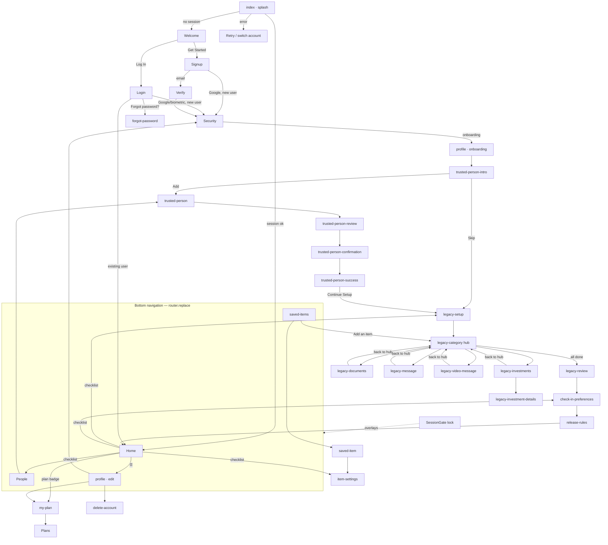

# Virasat Mobile — UI/UX Audit

**Date:** 2026-10-17
**Scope:** All 33 routes in `app/` plus shared components in `src/components/` and tokens in `src/theme/`
**Standards:** Material 3 (Android), Apple Human Interface Guidelines (iOS), WCAG 2.2 AA
**Status:** Report only. No code was changed.

---

## How this audit was done

- **Code.** I read every screen's render and styles, then ran scans over the whole codebase for font sizes, touch-target sizes, accessibility props, hardcoded colours, icon glyphs, and loading/empty/error handling.
- **Screenshots.** There is no `/ui-audit/screenshots/` folder. The 22 screenshots are in `screenshots/`. They were taken on a 720×1280 Android device (360×640 dp at 2×) on **2026-09-25**.
- **Screenshots are partly out of date.** 16 commits since then have changed or added screens. The clearest case is `22_dashboard.png`: it shows tabs labelled *Home / Legacy / Trusted / Settings*, while the code now has *Home / Vault / People / Profile*. Where code and screenshot disagree, **the code wins**. Screenshots are cited only for issues that still exist in the code.
- **Screens with no screenshot:** `people`, `saved-items`, `saved-item`, `item-settings`, `my-plan`, `plans`, `delete-account`, `forgot-password`, `profile` (edit mode), the splash screen (`index`), the lock screen (`SessionGate`), and `UpgradeModal`. I audited these from code only. **Recommendation:** take a new screenshot set before starting the redesign.
- **Contrast ratios** were calculated with the WCAG relative-luminance formula from the hex values in `src/theme/colors.ts`.

**Priority levels**

| Priority | Meaning |
|---|---|
| **High** | Breaks accessibility compliance, misleads the user about the state of their legacy, or blocks or confuses a core task. Fix before the next release. |
| **Medium** | Clear usability or consistency problem. Users can work around it, but it hurts trust and polish. |
| **Low** | Polish, copy, or a nice-to-have. |

---

## 1. Executive summary

Virasat has a strong, fitting brand idea: deep forest green, warm ivory, a Playfair Display serif for headings and Inter for interface text. It suits a calm, trustworthy product about legacy. The onboarding copy is warm and human.

The execution has not kept up with the idea. Each of the 33 screens was built as its own island: its own header, back button, progress bar, button and text styles. The theme tokens exist but are mostly ignored. As a result, **the app is not accessible today, and it looks less trustworthy than the brand intends.**

**The ten things that matter most**

1. **Text is far too small across the app.** There are **~240 font-size declarations below 12**, with values as low as **8.5**, mostly on Home. Material and Apple both treat ~11–12 as the absolute floor for captions, and body text should be 14–17.
2. **No text works with screen readers or larger system text.** 27 of 33 screens have **zero `accessibilityLabel`s**, about 160 `Pressable`s have no role, icons are text glyphs that screen readers read aloud, and nothing has been tested with large system font sizes.
3. **Touch targets are below minimum.** Back buttons are 40×40, header icons on Home are 36×36, and text links ("Forgot password?", "Resend code", "Edit", "View all →") have no minimum height. The minimums are 48dp (Material) and 44pt (Apple).
4. **The main action often sits below the fold or behind the gesture bar.** This happens on Signup, Verify, Legacy setup, Category, Documents and Trusted review (screenshots 02, 03, 06, 07, 08, 15).
5. **There is no icon system.** Unicode glyphs (`▤ ₹ ✎ ◇ ⌑ ☰ ‹ ›`), full-colour emoji (`🔒 📄 📈 💌 ☎️ ⚠️ 👤`) and Lucide icons are mixed, sometimes on the same screen. The `lucide-react-native` library is installed but used on only 4 screens.
6. **Status signals can mislead.** The Home trusted-person card shows a ✓ even when no one has been added. A grey, disabled-looking "Continue" button is actually tappable. The Verify screen prints the literal text "your email address" instead of the user's email.
7. **Navigation is inconsistent.** Tab screens (Vault, People, Profile) show a back arrow. Tabs switch with `router.replace`, so each tab's scroll position and state are lost. On Home, a ☰ "menu" icon opens Profile, which the tab bar already does.
8. **There are four different progress indicators,** some hard-coded or showing "all done" on the first step (screenshots 05, 06, 13, 14).
9. **Loading, empty and error states are uneven.** People and Item settings handle all three well. Home shows a fake "Loading your vault…" headline next to real counts, and Vault shows a lone spinner and a one-line empty message. No list supports pull-to-refresh.
10. **Several design choices look dated:** centred hero text everywhere, tracked-out ALL-CAPS labels above every heading, "→" arrows in button text, a dashed web-style upload box, Title Case headings, a text "G" instead of the official Google logo, and no dark mode even though `app.json` sets `userInterfaceStyle: "automatic"`.

**Suggested order:** make one shared set of building blocks (section 6) → fix accessibility and touch targets across all screens (H-1 to H-6) → fix the misleading states → redesign Home and Vault → restyle the onboarding flow.

---

## 2. Screen map and navigation flow

### 2.1 Route inventory

| # | Route (`app/…`) | Purpose | Screenshot | Group |
|---|---|---|---|---|
| 1 | `index.tsx` | Splash and session check (fixed 1.2 s delay) | — | Boot |
| 2 | `(auth)/welcome` | Welcome / value pitch | 01 | Entry |
| 3 | `(auth)/signup` | Create account | 02 | Entry |
| 4 | `(auth)/verify` | Email one-time code | 03 | Entry |
| 5 | `(auth)/login` | Sign in (password, Google, biometrics) | 21 | Entry |
| 6 | `(auth)/forgot-password` | 3-step reset (email → code + new password → done) | — | Entry |
| 7 | `(auth)/security` | Biometric opt-in (onboarding, and from Profile) | 04 | Onboarding / Settings |
| 8 | `(auth)/profile` | Onboarding: complete profile · Edit mode: **Profile tab** | 05 | Onboarding / Tab |
| 9 | `(auth)/trusted-person-intro` | Explains the trusted person | 13 | Onboarding |
| 10 | `(auth)/trusted-person` | Add or edit a trusted person form | 14 | Trusted flow |
| 11 | `(auth)/trusted-person-review` | Review details and choose when to notify | 15 | Trusted flow |
| 12 | `(auth)/trusted-person-confirmation` | Confirm a second time and save | 16 | Trusted flow |
| 13 | `(auth)/trusted-person-success` | Saved confirmation | 17 | Trusted flow |
| 14 | `(auth)/legacy-setup` | Pick categories to preserve | 06 | Legacy flow |
| 15 | `(auth)/legacy-category` | Hub for the selected categories | 07 | Legacy flow |
| 16 | `(auth)/legacy-documents` | Upload documents | 08 | Legacy flow |
| 17 | `(auth)/legacy-investments` | List financial assets | 09 | Legacy flow |
| 18 | `(auth)/legacy-investment-details` | Add one financial asset (form) | 10 | Legacy flow |
| 19 | `(auth)/legacy-message` | Write a personal message | 11 | Legacy flow |
| 20 | `(auth)/legacy-video-message` | Record a video message (camera permission) | 12 | Legacy flow |
| 21 | `(auth)/legacy-review` | Final review of the legacy | 18 | Legacy flow |
| 22 | `(auth)/check-in-preferences` | Check-in frequency, time and channel | 20 | Rules |
| 23 | `(auth)/release-rules` | Missed check-in escalation rules | 19 | Rules |
| 24 | `(auth)/home` | **Home tab** / dashboard | 22 (out of date) | Tab |
| 25 | `(auth)/saved-items` | **Vault tab** / item list (filter by category) | — | Tab |
| 26 | `(auth)/saved-item` | Item detail, edit, export | — | Vault |
| 27 | `(auth)/item-settings` | Assign recipient and policy to an item | — | Vault |
| 28 | `(auth)/people` | **People tab** / trusted circle | — | Tab |
| 29 | `(auth)/my-plan` | Current plan and billing | — | Account |
| 30 | `(auth)/plans` | Plan comparison (paid plans "Coming soon") | — | Account |
| 31 | `(auth)/delete-account` | Re-authenticate and delete account | — | Account |
| 32 | `(auth)/dev-screen` | Developer navigator (`__DEV__` builds only) | — | Dev |
| 33 | `SessionGate` (component) | Biometric lock overlay and session error | — | Global |
| — | `UpgradeModal` (component) | Plan-limit upsell (People, Messages, Video, Check-ins) | — | Global |

### 2.2 Flow diagram

### 2.3 Problems with the navigation structure

| ID | Screen | Problem | Why it matters | Recommended fix | Priority |
|---|---|---|---|---|---|
| NAV-1 | Home, Vault, People, Profile | The tabs are not a real tab navigator. `BottomNavBar` calls `router.replace` on each tap. | Each tab reloads from scratch: scroll position and form drafts are lost, and there is no native tab animation or tab history. Android back exits from any tab. | Move the four screens into an Expo Router `(tabs)` group using `Tabs` (or `NativeTabs` in SDK 57) and keep the stacks for the flows. | High |
| NAV-2 | Vault, People, Profile (edit) | Tab roots show a back arrow (`‹ Back`, `‹`), and People's back arrow does `router.replace('/home')`. | A back arrow on a tab breaks both Apple and Material patterns and suggests the screen is nested. | Remove back arrows from tab roots and use a large title instead. | High |
| NAV-3 | Home | The ☰ "menu" icon opens Profile, which the Profile tab also opens. The plan badge (9.5 font) is a hidden link to My Plan. | Hamburger menus on a screen with a tab bar are an outdated pattern, and two routes to one place add noise. | Remove ☰. Put an avatar button (top right) or the Profile tab in charge of account. Make the plan badge a labelled row in Profile. | Medium |
| NAV-4 | Trusted flow | Four screens (form → review → confirm → success) to add one person. Review and Confirmation show the same card. | Extra steps cause drop-off, and the duplicate confirmation feels like a bug. | Merge Review and Confirm into one "Review & save" screen with the notify-now/later choice. Keep Success as a short sheet or toast. | Medium |
| NAV-5 | Item settings, Legacy documents/messages/investment details | Back or finish actions do `router.replace('/home')`, which skips the screen the user came from. | Users who came from Vault or Saved item land somewhere unexpected and lose their place. | Use `router.back()` or `dismissTo` the actual origin. Reserve `replace` for the end of a flow. | Medium |
| NAV-6 | Home checklist → `item-settings` | The checklist pushes `item-settings` with no `itemId`. | The user lands on a generic picker with no context; it only works because the screen falls back to a picker. | Route through Vault ("Pick an item to assign") or pre-select the first unassigned item. | Low |
| NAV-7 | Splash (`index`) | Fixed 1200 ms `setTimeout` before routing. | Every launch is 1.2 s slower than needed; leading apps get to content in under 400 ms. | Route as soon as the session check finishes; keep the logo animation but don't block on it. | Medium |

---

## 3. Issues that affect every screen

These come from the shared foundations, so fixing each once fixes it everywhere.

| ID | Screens | Problem | Why it matters | Recommended fix | Priority |
|---|---|---|---|---|---|
| H-1 | All (worst on Home, Release rules, Check-in, Legacy review, Login) | **Text is too small.** About 240 `fontSize` values are under 12: Home section labels 9.5, meta labels 8.5, legacy card titles 11.5, check-in description 10.5, security note 9.5; the Input error text is 11; nav bar labels are 10.5. | Unreadable for older users, who are a core audience for a legacy app. Fails Apple's 11pt minimum and Material's 12sp label minimum, and fails WCAG 1.4.4 in practice. | Adopt the type scale in §6.2: nothing below 12, body 15–16, captions 13. Remove every inline `fontSize` and use type tokens only. | High |
| H-2 | All | **Touch targets are too small.** Back buttons are 40×40 on 24 screens; Home header icons are 36×36; text links have no minimum size; the signup terms checkbox is ~20dp; the plan badge is ~16dp tall. | Missed taps and frustration, especially one-handed. Below Material's 48dp and Apple's 44pt minimums, and WCAG 2.5.8. | One `IconButton` at 48×48 and one `TextLink` with `minHeight: 44` plus padding. Checkbox hit area 48×48 with the whole label row tappable. | High |
| H-3 | 27 of 33 screens | **No accessible names or roles.** About 160 `Pressable`s have no `accessibilityRole`; glyph icons are read aloud ("black right-pointing triangle", "rupee sign"); checkboxes and radios don't report checked state; error messages don't use `accessibilityLiveRegion` or the alert role, except in `index`, `saved-*` and `delete-account`. | The app can't be used with TalkBack or VoiceOver (WCAG 4.1.2, 1.1.1). That's an exclusion and a store-review risk for an app that handles inheritance. | Every interactive element goes through a shared component that requires `accessibilityLabel` and sets role and state. Decorative icons get `accessible={false}`. Selection controls use `accessibilityRole="checkbox"/"radio"` with `accessibilityState={{checked}}`. | High |
| H-4 | All | **Text scaling has never been tested.** Fixed `height` on inputs (52) and buttons (54/56), fixed-size circles holding text, and no `maxFontSizeMultiplier` strategy. | At 1.3× system font size (common for users over 50), labels clip, buttons overflow and 2-column rows break. | Use `minHeight` instead of `height` everywhere. Allow scaling up to ~1.6× on body text and cap only very large display headings. Test at 200%. | High |
| H-5 | All | **Contrast failures.** `textMuted #7A8783` on ivory is **3.42:1** and on white is 3.74:1 (used 96 times, including placeholders and helper text). Input and card borders `#D7E1DD` are **1.34:1** on white and **1.23:1** on ivory. `success #35B86B` on white is 2.55:1 and `warning #F4A62A` is 2.03:1. Disabled buttons show text at ~1.6:1 (screenshots 09, 21). | Fails WCAG 1.4.3 (4.5:1 for text) and 1.4.11 (3:1 for field edges). Input fields barely show their edges on the ivory background. | Darken muted text to `#5E6B67` (5.1:1). Field outline `#788B85` (3.3:1). Use dark versions of success and warning for text (§6.1). Disabled state: solid `#C9D3CF` fill with `#5E6B67` text instead of a 50% opacity fade. | High |
| H-6 | All | **No icon system.** There are 19 different Unicode glyphs and about 20 full-colour emoji, plus Lucide icons on 4 screens. Example: Legacy review shows 📄📈💌, Home shows `▤ ₹ ✎`, and Trusted review shows a red ☎️. | Emoji look different on every phone (Samsung vs Pixel vs iOS), clash with the calm green palette, can't be recoloured or resized consistently, and are poor for screen readers. This is the single biggest "unfinished" signal in the app. | Use Lucide (already installed) everywhere: 24dp, 1.75 stroke, `currentColor`. Use SF Symbols via `expo-symbols` on iOS if a native feel is wanted. Ban emoji in the UI. | High |
| H-7 | Signup, Verify, Legacy setup, Category, Documents, Trusted review, Release rules | **The main action is off-screen.** Primary buttons sit at the end of the scroll and are cut off or sit behind the gesture bar on a 360×640 screen (screenshots 02, 03, 06, 07, 08, 15). | Users can't see how to move on. On short phones the action collides with the system gesture area. | Pin the button in a bottom action bar (as People, Profile and Legacy investments already do) with `paddingBottom = max(insets.bottom, 16)` and a top divider when content scrolls under it. | High |
| H-8 | Legacy investments; Legacy setup | **A button looks disabled but works.** "Continue" uses `styles.buttonDisabled` when there are no assets but stays tappable (`legacy-investments.tsx:276`), next to the line "You can add assets later". | It contradicts itself: sighted users think they're blocked, and screen-reader users get no state at all. | If skipping is allowed, show an enabled secondary "Skip for now" plus a primary "Add asset". Only make a button look disabled when it truly is, with `accessibilityState.disabled`. | High |
| M-1 | 24 screens | **Each screen builds its own header.** The back-button offset varies (left 0 or 24 → x = 58 or 87 px in the screenshots). The logo sits at y = 70 on Signup and y = 120 elsewhere. Some screens have no header at all (Login, Success). | Small jumps between screens make the app feel unstable. | One `ScreenHeader` with a 56dp bar, 48dp leading icon, centred wordmark or title, and an optional trailing action. | Medium |
| M-2 | Profile, Trusted intro, Trusted person, Legacy flow, Success | **Four different progress indicators:** 6 dots and lines (Profile), 10 dots and lines (Trusted intro), inset dashes (Trusted person), full-width dashes (Legacy flow), plus a decorative dash row on Success. Several are hard-coded; Legacy setup showed 10 of 10 filled on the *first* step (06). The current code has also dropped the indicator from most legacy screens and left the styles behind. | The user can't tell how far along they are. "All filled" on step 1 is simply wrong. | One `StepProgress` component fed by a single onboarding config, with three labelled phases (Account · Legacy · Rules) instead of 10 tiny segments. Add `accessibilityRole="progressbar"` and a text label such as "Step 2 of 3". | Medium |
| M-3 | All | **Buttons don't match.** Heights are 48, 50, 52, 54 and 56; radii are 12 and 14; fills alternate between `forest` and `deepForest`; text sizes range 12.5–17; "→" is appended to labels. Only 3 screens use the shared `Button`. | Users can't tell which button is the main one, and the screens look stitched together. | Make `Button` the only button, with variants `primary / secondary / tertiary / destructive` and sizes `md 48 / lg 56` (§6.4). Remove arrow glyphs from labels. | Medium |
| M-4 | Login vs Signup/Profile | **Form labels don't match.** Login uses tracked ALL-CAPS labels ("EMAIL ADDRESS"); Signup and Profile use sentence case with an asterisk; Investment details uses no asterisk and an "Optional" tag; dropdown arrows are a letter **"v"** (05, 14) on some screens and "▼" (10) on others. | Inconsistent conventions slow form filling and look careless. | Mark *optional* fields only (most fields are required). Use sentence-case labels and one `Select` component with a Lucide `ChevronDown`. | Medium |
| M-5 | All | **Theme tokens are bypassed.** About 150 hardcoded hex colours (`#B42318`, `#9B1C1C`, `#FDE8E8`, `#991B1B`…), three different error reds, and inline spacing values like 15, 17, 19, 22 and 27. | Visual drift, and dark mode is impossible. | Semantic colour tokens (§6.1) and a lint rule against raw hex in `app/`. | Medium |
| M-6 | All | **No dark mode, but the app follows the system setting.** `app.json` has `userInterfaceStyle: "automatic"`, but every colour is fixed for light mode. | On a dark-mode phone, system parts (keyboard, alerts, date picker, status bar) turn dark against the ivory app, which looks broken. A night-time dark theme is now expected. | Short term: set `"light"`. Long term: add the dark tokens in §6.1. | Medium |
| M-7 | All | **ALL-CAPS tracked labels sit above nearly every heading** ("YOUR DIGITAL LEGACY", "IMPORTANT DOCUMENTS", "FINAL REVIEW", "ALMOST THERE"…) and repeat inside cards ("TRUSTED PERSON", "ITEMS PRESERVED"). | They look templated, read badly for screen readers (some spell out letter by letter), and add noise without adding information. | Drop these labels on full screens. Use sentence-case section titles at 13/600 only where they actually group content. | Low |
| M-8 | Home, Vault, People | **No pull-to-refresh** (`RefreshControl` is used 0 times). | Refreshing a list by pulling is the standard on both platforms, and users will try it. | Add `RefreshControl` to every list and dashboard `ScrollView`. | Medium |
| M-9 | Home, Legacy screens | **Errors pop up twice.** `Alert.alert` is used for refresh failures (Home) and is also shown as a banner; there are 21 `Alert.alert` calls in total. | Interrupting dialogs for recoverable errors feel hostile and duplicate the inline banner. | Inline banner or snackbar for recoverable errors. Keep `Alert` for confirming destructive actions only. | Medium |
| L-1 | All | Some headings use Title Case ("Choose Your Legacy Shield", "Current Plan", "Personal Details", "Message Title", "Add Financial Asset") and the rest use sentence case. | Inconsistent voice. | Sentence case everywhere. | Low |

---

## 4. Per-screen findings

Each table lists only issues specific to that screen. Shared issues from §3 apply on top.

### 4.1 Splash — `index.tsx`
| ID | Problem | Why it matters | Recommended fix | Priority |
|---|---|---|---|---|
| S-1 | Fixed 1.2 s delay before routing (see NAV-7). The loading text "Preparing your vault" with animated dots never says how long it will take. | Slow perceived start. | Route on ready. Show text only if the check takes more than 1 s. | Medium |
| S-2 | The error card's "!" glyph sits in a circle; errors use `accessibilityRole="alert"`. ✅ It has a good retry and switch-account path. | — | Keep it. Swap in a Lucide `AlertCircle`. | Low |

### 4.2 Welcome — `welcome.tsx` (01)
| ID | Problem | Why it matters | Recommended fix | Priority |
|---|---|---|---|---|
| W-1 | Everything is centred: heading, a 4-line paragraph and the trust row. The paragraph is centred body text. | Centred multi-line text is slower to read and looks like a 2018 landing page. | Left-align heading and body. Keep only the button full-width. | Medium |
| W-2 | Nothing visual shows what Virasat does: just text on ivory. | Leading apps in this category (Trust & Will, GoodTrust) open with an illustration or a short carousel showing the outcome (documents, people, release). | Add a single quiet illustration or a 3-panel swipe ("Store · Choose people · Decide when"), with Get started fixed at the bottom. | Medium |
| W-3 | The "Log In" link is a bare `Pressable` around text: no role, and the target is about 24dp tall. | Hard to tap, and screen readers don't announce it as a button. | Secondary button ("I already have an account"), 48dp tall. | High |
| W-4 | The "✓ Secure & Private" trust badge is 12–13 text in a tiny circle. | Weak trust signal. | One line with a Lucide `ShieldCheck` and a concrete claim, e.g. "Encrypted. Only released on your rules." | Low |
| W-5 | "DEV: Screen Navigator" appears in the screenshot. It is wrapped in `__DEV__`, so it isn't in production. ✅ | — | Take screenshots from release builds. | Low |

### 4.3 Sign up — `signup.tsx` (02)
| ID | Problem | Why it matters | Recommended fix | Priority |
|---|---|---|---|---|
| SU-1 | The "Create Account" button is hidden behind the gesture bar at 360×640 (H-7). | The main action of the funnel is invisible. | Pin it at the bottom. Move the terms line under the button as small print ("By continuing you agree to…") instead of a checkbox if legal allows. | High |
| SU-2 | The terms checkbox is ~20dp; only the box is tappable, not the label. | Below minimum touch size, and checkbox state isn't announced. | Make the whole row tappable (48dp) with `accessibilityRole="checkbox"`. | High |
| SU-3 | The password checklist uses empty grey circles (low contrast, no ✓/✗ icon change visible until typing). | Users can't see the requirements are rules. Colour-only state change. | Use a check/dot icon plus text. Announce changes through a live region. | Medium |
| SU-4 | The "Show" toggle is plain text with no role. | Screen readers can't use it. | Icon button (`Eye`/`EyeOff`) 48dp, labelled "Show password". | Medium |
| SU-5 | No Google sign-up button above the fold. Login has it, Signup doesn't show it first. | Social sign-up is the fastest path and is standard. | Put "Continue with Google" (and Apple on iOS, which App Store rules require when other social logins are offered) at the top, then "or use email". | High |

### 4.4 Verify email — `verify.tsx` (03)
| ID | Problem | Why it matters | Recommended fix | Priority |
|---|---|---|---|---|
| V-1 | Falls back to the literal text **"your email address"** in highlighted green (`verify.tsx:277`). The screenshot shows it. | Looks like a template bug, and users can't confirm where the code went. | Always pass the email, or hide that line. Add "Wrong email? Change". | High |
| V-2 | The "Resend code" link is grey while the timer runs, with no countdown on the link itself. | Users can't tell whether it's disabled or just styled that way. | "Resend code in 0:42" (disabled), then "Resend code" (enabled), with a 48dp target. | Medium |
| V-3 | The envelope glyph `✉` is tiny inside a 56dp circle. | Looks unfinished. | Lucide `MailCheck` at 28dp. | Low |
| V-4 | Six code boxes (~45dp each) with no paste support visible. | Copy-paste from the email is the common path. | Accept a pasted 6-digit code, auto-submit when complete, and offer "Open email app". | Medium |
| V-5 | The Verify button is below the fold (03). | Same as H-7. | Pin it, or auto-submit. | High |

### 4.5 Login — `login.tsx` (21)
| ID | Problem | Why it matters | Recommended fix | Priority |
|---|---|---|---|---|
| L-1 | ALL-CAPS labels don't match Signup (M-4). | Inconsistent. | Sentence case. | Medium |
| L-2 | The disabled Sign In button's text is about 1.6:1 contrast. | Unreadable (H-5). | Use the disabled token. Better: keep the button enabled and validate on press. | High |
| L-3 | The Google button uses a text "G" (`googleIcon`). | Violates Google's sign-in branding rules and looks fake, which is a problem for a security app. | Use the official multicolour Google "G" asset, or `GoogleSigninButton`. | Medium |
| L-4 | "Forgot password?" is a 12–13 link with no minimum height. "Create a new Virasat →" is unclear wording. | Small target. The copy doesn't say what it creates. | 44dp link. "Create an account". | Medium |
| L-5 | The order is biometric card → email/password → Google → signup. The biometric card shows at the top only when enrolled. ✅ Good idea. | — | Keep it. On iOS, consider passkeys as the next step. | Low |

### 4.6 Forgot password — `forgot-password.tsx` (no screenshot)
| ID | Problem | Why it matters | Recommended fix | Priority |
|---|---|---|---|---|
| FP-1 | Three steps on one screen controlled by component state. Hardware or gesture back leaves the whole flow instead of going back one step. | Unexpected exit loses progress. | Intercept back with `usePreventRemove` to go back a step, or split into routes. | Medium |
| FP-2 | Uses Lucide icons, `primary.forest` for the button and a 50dp height. These differ from the rest of the app (M-3). | Inconsistent. | Use the shared Button. | Low |

### 4.7 Security / biometrics — `security.tsx` (04)
| ID | Problem | Why it matters | Recommended fix | Priority |
|---|---|---|---|---|
| SE-1 | When biometrics are unavailable, the card shows small grey text, while the checklist below still says "✓ Your vault is protected" and "✓ Your biometric data stays on your device". | Claims protection that isn't on. Misleading on a security screen. | Change the checklist to match the real state. Offer a device-passcode fallback or "Set up fingerprint in Settings" (deep link). | High |
| SE-2 | The icon is a `◈` glyph in a large circle (decorative and meaningless). | Visual noise. | Lucide `Fingerprint` / `ScanFace`, chosen by the available hardware. | Low |
| SE-3 | The `Switch` row needs a label tied to it (`accessibilityLabel` on the Switch). | Otherwise the Switch is announced without a name. | Label it "Unlock with fingerprint". | Medium |

### 4.8 Profile — `profile.tsx` (05, plus edit mode = Profile tab)
| ID | Problem | Why it matters | Recommended fix | Priority |
|---|---|---|---|---|
| P-1 | **Edit mode combines a form and a settings menu.** A sticky "Save Changes" button stays on top of the tab bar at all times, even when nothing has changed. | Two stacked bottom bars eat ~140dp of a 640dp screen, and a constantly active Save button invites accidental taps. | Make the Profile tab a settings list (Account, Plan, Security, Privacy, Sign out, Delete). Move "Personal details" to its own pushed screen whose Save is only enabled after a change. | High |
| P-2 | Country and Language sit side by side in two columns at 360dp. | Long values ("United Kingdom", "Bahasa Indonesia") get cut off, and it breaks with larger text. | Stack them in one column. | Medium |
| P-3 | Dropdown arrow is the letter "v". | Looks broken. | Lucide `ChevronDown`. | Medium |
| P-4 | Footer says "You can edit this information later from Settings" even when the user is already in Settings. | Confusing copy. | Show only during onboarding. | Low |
| P-5 | The danger zone uses a `⚠` glyph; Sign out and Delete use different reds (`#B42318`, the theme `error`). | Inconsistent destructive styling. | One `destructive` colour token. Group Sign out and Delete at the bottom with spacing. | Low |
| P-6 | The onboarding progress is 6 hard-coded dots (M-2). | — | Use the shared StepProgress. | Medium |

### 4.9 Trusted person intro — `trusted-person-intro.tsx` (13)
| ID | Problem | Why it matters | Recommended fix | Priority |
|---|---|---|---|---|
| TI-1 | Long screen: icon, centred heading, a "Why do I need one?" card and a "What happens?" list. Skip and Add buttons sit below the fold. | The decision is hidden. | Shorten to heading, 3 bullets with icons, and a pinned "Add trusted person" with a "Skip for now" text button. | Medium |
| TI-2 | 10-dot progress (M-2); the `◇` glyph means nothing. | — | — | Low |

### 4.10 Add trusted person — `trusted-person.tsx` (14)
| ID | Problem | Why it matters | Recommended fix | Priority |
|---|---|---|---|---|
| TP-1 | No "Choose from contacts" option. | Typing a name, email and phone by hand is slow and error-prone. Leading apps offer a contact picker. | Add `expo-contacts` picker as the first option, with a manual-entry fallback. | Medium |
| TP-2 | Relationship uses the "v" dropdown, and phone has no country code picker visible above the fold. | — | Shared Select. Phone input with a country prefix taken from the profile. | Medium |
| TP-3 | Both email and phone are required (*). | Higher friction; many people only know one. | Require at least one contact method. | Low |

### 4.11 Trusted review & confirmation — `trusted-person-review.tsx` (15), `trusted-person-confirmation.tsx` (16)
| ID | Problem | Why it matters | Recommended fix | Priority |
|---|---|---|---|---|
| TR-1 | Empty fields render as placeholders such as "Trusted Person", a "?" avatar, "No email provided", and **bare emoji with no text** on Confirmation (16). | Looks broken. The screen is meant to verify data. | These screens redirect without a draft. Never show a placeholder name; hide rows that have no value. | High |
| TR-2 | Red ☎️ and ✉️ emoji next to the green palette. | H-6. | Lucide `Phone` / `Mail` in muted colour. | High |
| TR-3 | The notify-now/later radio cards have no radio role, and only the circle shows selection. | Screen readers can't tell what's selected. | `accessibilityRole="radio"` on the card, with a border plus fill for the selected state. | High |
| TR-4 | Review and Confirmation show the same data (NAV-4). | Extra step. | Merge them. | Medium |
| TR-5 | "Edit →" is a 12–13 link (~20dp target). | H-2. | Text button with 44dp height. | Medium |

### 4.12 Trusted success — `trusted-person-success.tsx` (17)
| ID | Problem | Why it matters | Recommended fix | Priority |
|---|---|---|---|---|
| TS-1 | **The layout overlaps.** The success circle covers the VIRASAT wordmark and progress bar because `main` uses `flex:1; justifyContent:center; marginTop:-20` with no ScrollView. | A visible bug on small phones and with larger text. | Put the content in a ScrollView. Remove the negative margin. Drop the decorative progress row. | High |
| TS-2 | The info card sits directly against the CTA with no gap (17). | Cramped; the button looks like part of the card. | Pinned action bar with 16dp spacing. | Medium |
| TS-3 | "No invitation has been sent to **Your** trusted person" has a capital Y mid-sentence (the fallback name). Footer "Trusted person ✓" is unclear. | Copy bug. | Use the real name. Remove the footer. | Low |

### 4.13 Legacy setup — `legacy-setup.tsx` (06)
| ID | Problem | Why it matters | Recommended fix | Priority |
|---|---|---|---|---|
| LS-1 | Checkboxes are on the right with no checkbox role. The whole card is tappable, but the selected state is shown only by a small box. | Selection is hard to see and isn't announced. | Highlight the whole card when selected (border 2dp forest plus mint fill plus check icon). Use `accessibilityRole="checkbox"`. | High |
| LS-2 | Five categories on a 360dp screen; the Continue button is off-screen (H-7). | — | Pinned bar: "Continue with 2 selected". | High |
| LS-3 | Glyph icons `▤ ₹ ✎` (H-6). The ₹ symbol for "Investments" assumes Indian users. | Not neutral for other locales. | Lucide `FileText`, `Landmark`/`TrendingUp`, `PenLine`, `Video`, `Folder`. | Medium |

### 4.14 Legacy category hub — `legacy-category.tsx` (07)
| ID | Problem | Why it matters | Recommended fix | Priority |
|---|---|---|---|---|
| LC-1 | Each card shows a status ("Add now", grey) **and** a link ("Open & add →"). The status is low-contrast grey and says the same thing as the link. | Two signals, one meaning. Weak hierarchy. | Status chip ("Not started" / "2 added" / "Done ✓") at the top right; the whole card is tappable with a chevron. | Medium |
| LC-2 | The icon is centred vertically while the text is top-aligned. | Misaligned. | Align the icon to the top of the title. | Low |
| LC-3 | The finish button is below the fold. | H-7. | Pinned "Review my legacy" button with a count of completed categories. | High |

### 4.15 Documents — `legacy-documents.tsx` (08)
| ID | Problem | Why it matters | Recommended fix | Priority |
|---|---|---|---|---|
| LD-1 | A dashed "Add a document" drop zone is a web-only pattern; you can't drag and drop on a phone. | Looks like a desktop page. | Use an action sheet with three choices: "Scan document" (camera), "Choose photo", "Choose file". Scanning is the top expectation in this category. | Medium |
| LD-2 | The "Private by design" box uses a 🔒 emoji. | H-6. | Lucide `Lock`. | Medium |
| LD-3 | Uploads show no per-file progress or failure state. The CTA is disabled until a file exists. | Users can't tell whether an upload worked. | File rows with a progress bar, retry and remove options. "Skip for now" as a secondary action. | Medium |

### 4.16 Investments list and details — `legacy-investments.tsx` (09), `legacy-investment-details.tsx` (10)
| ID | Problem | Why it matters | Recommended fix | Priority |
|---|---|---|---|---|
| LI-1 | Continue looks disabled but works (H-8). | — | — | High |
| LI-2 | The "Add Financial Asset" card is styled like an info box, not a button. | Weak affordance. | Use an outlined "Add asset" button or a list "+" row. | Medium |
| LI-3 | Details form: labels have no required marker but use an "Optional" tag on the right (inconsistent with M-4). "Investment type" uses a `▼` glyph. | — | Shared form conventions. | Medium |
| LI-4 | ✅ Good warning: "Never store passwords, PINs, OTPs…". | Builds trust. | Keep it. Make it a proper inline notice with an icon. | — |

### 4.17 Personal message — `legacy-message.tsx` (11)
| ID | Problem | Why it matters | Recommended fix | Priority |
|---|---|---|---|---|
| LM-1 | The message box is a fixed-height box with a "0 characters" counter. Who the message is for is asked below the fold. | Writing a legacy message is emotional and long. The recipient matters more than the character count. | Ask "Who is this for?" first. Let the editor grow with the text. Autosave the draft with a "Saved" indicator. Show a count only near the limit. | Medium |
| LM-2 | Title Case labels ("Message Title", "Your Message"). | L-1. | Sentence case. | Low |

### 4.18 Video message — `legacy-video-message.tsx` (12)
| ID | Problem | Why it matters | Recommended fix | Priority |
|---|---|---|---|---|
| LV-1 | The permission screen mixes a centred icon, a left-aligned heading and a centred, non-full-width button in `primary.forest`. | Mixed alignment and a different button style from the rest of the app. | One layout system: left-aligned, full-width button pinned at the bottom. | Medium |
| LV-2 | Uses a ▶ "play" icon to ask for camera permission. | Wrong meaning. | Lucide `Video` / `Camera`. | Low |
| LV-3 | If permission is permanently denied, no "Open Settings" link is visible in the screenshot. | Dead end. | When `canAskAgain === false`, change the button to "Open Settings" (`Linking.openSettings()`). | High |

### 4.19 Legacy review — `legacy-review.tsx` (18)
| ID | Problem | Why it matters | Recommended fix | Priority |
|---|---|---|---|---|
| LR-1 | Full-colour emoji icons 📄📈💌, including a red chart line that suggests a loss. | H-6, and it misreads as a financial warning. | Lucide icons. | High |
| LR-2 | The trusted-person card says "Edit" when no one has been added. | Wrong verb. | "Add" (or "Add trusted person"). | Low |
| LR-3 | Categories with "0 items" look the same as completed ones. | The user can't see what's missing before activating. | Show an incomplete state (amber dot plus "Not added yet") and a summary such as "2 of 4 complete". | Medium |

### 4.20 Check-in preferences — `check-in-preferences.tsx` (20)
| ID | Problem | Why it matters | Recommended fix | Priority |
|---|---|---|---|---|
| CI-1 | "Schedule" looks like a text input but only shows a fixed value ("Monthly check-in"). | Users try to type in it. | Show it as plain text or remove it, since Frequency already says this. | Medium |
| CI-2 | Weekly and Monthly are separate stacked cards, and the time row's "›" doesn't say it opens a picker. | — | Segmented control (Weekly / Monthly) and a time row with a `Clock` icon. | Low |
| CI-3 | 12 font sizes below 12, and ALL-CAPS section labels. | H-1 / M-7. | — | High |

### 4.21 Release rules — `release-rules.tsx` (19)
| ID | Problem | Why it matters | Recommended fix | Priority |
|---|---|---|---|---|
| RR-1 | The quoted chip `"I'm safe & active"` looks like a button but does nothing. | False affordance. | Show it as a preview of the notification ("You'll get a notification with an 'I'm safe' button"). | Medium |
| RR-2 | The missed check-in timeline uses grey numbered circles in a thin column, with 15 font sizes below 12. | This is the most important trust concept in the app (when do my things get released?), and it's hard to read. | Make it the centrepiece: a vertical timeline with day numbers (Day 0 / +7 / +14 / +30), what happens at each step, and who is contacted. | High |
| RR-3 | The heading "Decide when Virasat should start looking for you." wraps to 3 lines at 28pt. | Takes up most of the first screen. | Shorter heading ("Release rules") with the reassurance as body text. | Low |

### 4.22 Home — `home.tsx` (22, out of date)
| ID | Problem | Why it matters | Recommended fix | Priority |
|---|---|---|---|---|
| HO-1 | **The smallest text in the app:** section titles 9.5, meta labels 8.5, statuses 9, card titles 11.5, security note 9.5, "View all →" 10.5. | H-1. This is the most-viewed screen. | Rebuild on the new type scale. | High |
| HO-2 | **The trusted-person card shows a green ✓ even when there is no trusted person** ("ACTION REQUIRED"). | A misleading safety signal. | The status icon must match the state: `UserPlus` with an amber tint when missing, `UserCheck` when active. | High |
| HO-3 | **"Loading your vault…" is the card headline** while the item count already shows a number (22: "1"). There's no skeleton. | Mixed signals. | Skeleton placeholders for the card and grid while loading. Never show real counts during a loading state. | Medium |
| HO-4 | Order of content: header → error → greeting → check-in → 4-step checklist → dark overview card → 5-card grid → trusted card → check-in (again, if not set) → disclaimer. The most important actions sit low on the screen. | The main job of Home is "Is my legacy ready, and what should I do next?" | Recommended order: greeting → **one readiness card** (progress ring plus the single next step as a button) → check-in due (only when pending) → legacy categories → trusted people. Move the disclaimer to Profile → About. | High |
| HO-5 | Five category cards in a 2-column grid leave one orphan card, each only ~160dp wide. | Unbalanced. | A horizontal scroll of category chips, or a single list with counts. | Medium |
| HO-6 | "AWS S3 Encrypted" badge. | Infrastructure jargon. It means nothing to users and may raise questions ("is AWS reading my will?"). | "End-to-end encrypted" or "Encrypted at rest", only if true, linking to a short explainer. | Medium |
| HO-7 | ☰ icon, plan badge and dev icon in the header (NAV-3). Header buttons are 36×36. | H-2. | Avatar button (48dp). | Medium |
| HO-8 | The "Confirm I'm active" button lives in a card in the middle of the scroll. | The highest-stakes action in the app isn't prominent. | When a check-in is pending, show a pinned banner at the top (and use a notification action). | High |
| HO-9 | The error banner uses its own reds (`#FDE8E8`, `#9B1C1C`) and also opens an `Alert`. | M-5 / M-9. | Shared InlineNotice. | Medium |
| HO-10 | Leftover `bottomNav` styles (unused). | Code hygiene. | Delete them. | Low |

### 4.23 Vault list — `saved-items.tsx` (no screenshot)
| ID | Problem | Why it matters | Recommended fix | Priority |
|---|---|---|---|---|
| VA-1 | **Looks like a different app.** It uses `vaultScreenStyles`, plain text links ("‹ Back"), and rows that show raw enum values (`DOCUMENTS · FILE`). There are no icons or thumbnails. | The vault is the core of the product and looks the least finished. | Large title "Vault", search field, category filter chips, and rows with type icon, title, meta ("PDF · 2.1 MB · Updated 3 Oct") and a trailing assignment status. | High |
| VA-2 | The empty state is one line: "No saved items in this category yet." | A missed chance to prompt action. | Illustration, one sentence, and a primary "Add your first document" button. | Medium |
| VA-3 | Loading is a bare `ActivityIndicator` with no label. | Screen readers announce nothing. | Skeleton rows, or a spinner with `accessibilityLabel="Loading items"`. | Medium |
| VA-4 | "Add an item" is a full-width primary button above the list. | It pushes content down on every visit. | A floating action button (Material) or a "+" in the top bar (iOS). | Medium |
| VA-5 | The tab root shows "‹ Back" (NAV-2). | — | — | High |

### 4.24 Saved item — `saved-item.tsx`
| ID | Problem | Why it matters | Recommended fix | Priority |
|---|---|---|---|---|
| SI-1 | Two stacked filled primary buttons ("Edit title and contents", "Save or open file"), plus text links. | No single main action. | Top bar: Edit (text button) and a ⋯ menu (Export, Release settings, Delete). Main body: a file preview card with an "Open" button. | Medium |
| SI-2 | **No delete action** for an item on its detail screen. | Users expect to remove items from the item itself. | Destructive "Delete item" in the ⋯ menu with a confirmation. | Medium |
| SI-3 | Buttons show "Saving…" text as their only loading state, and the TextInputs have no visible labels tied to them (the labels are separate `Text` elements). | Weak feedback. | Shared Button with a spinner; Input with a linked label. | Low |

### 4.25 Item settings — `item-settings.tsx`
| ID | Problem | Why it matters | Recommended fix | Priority |
|---|---|---|---|---|
| IS-1 | ✅ Numbered steps (1. Item, 2. Recipient, 3. Policy) are a real sequence, and empty and error states are handled. | Good. | Keep them. Change the ALL-CAPS step labels to sentence case. | — |
| IS-2 | Back does `router.replace('/home')` (NAV-5). The "VERSION n" policy badge is technical. | — | Use `router.back()`. Hide the version number. | Medium |

### 4.26 People — `people.tsx`
| ID | Problem | Why it matters | Recommended fix | Priority |
|---|---|---|---|---|
| PE-1 | ✅ Complete loading, empty and error states, and a pinned "Add Trusted Person" button with good thumb reach. | This is the model for the other list screens. | — | — |
| PE-2 | Tab root has a back arrow (NAV-2). The empty state uses a 👤 emoji. | — | Lucide `Users`. | High |
| PE-3 | "🔒 ID Verification Required" / "Direct Authorized Access" tags use an emoji and jargon. | Unclear meaning. | "Must verify ID before access" with a `BadgeCheck` icon. | Low |
| PE-4 | The over-limit banner is a long block of text using an `ℹ` glyph. | Hard to scan. | Two lines plus an "Upgrade" link. | Low |

### 4.27 My plan and Plans — `my-plan.tsx`, `plans.tsx`
| ID | Problem | Why it matters | Recommended fix | Priority |
|---|---|---|---|---|
| PL-1 | Paid plans show **"Coming soon"** inside a primary-style button, and `UpgradeModal` → "View Plans" leads here. | The upsell funnel ends at a dead end, which breaks trust. | Until purchases work, change upsell copy to "Join waitlist", or hide the upsell. Make "Coming soon" a neutral chip, not a button. | High |
| PL-2 | "Refresh Account Subscription" is jargon. Store convention is "Restore purchases". | Store review expects the standard term on iOS. | "Restore purchases". | Medium |
| PL-3 | Title Case headings and an ALL-CAPS "🛡 CONTINUITY GUARANTEE". | L-1, H-6. | — | Low |
| PL-4 | Plan cards are a long vertical stack. | Hard to compare. | A comparison table or segmented cards with the features that differ highlighted. | Low |

### 4.28 Delete account — `delete-account.tsx`
| ID | Problem | Why it matters | Recommended fix | Priority |
|---|---|---|---|---|
| DA-1 | ✅ Good structure: warning, re-authentication, type-to-confirm, and "Keep account" as the safe primary action. Errors use the alert role. | — | Keep it. | — |
| DA-2 | The delete button requires `currentPassword` (`disabled={… \|\| !currentPassword}`), and the Google confirmation is a separate button underneath. | Google-only users may see a permanently disabled Delete button, which looks like a dark pattern. | Choose the re-auth method automatically by sign-in provider and show one path. | Medium |
| DA-3 | The ⚠️ emoji and its own red palette (`#991B1B`, …). | M-5. | Destructive tokens. | Low |

### 4.29 Lock screen and session errors — `SessionGate.tsx`
| ID | Problem | Why it matters | Recommended fix | Priority |
|---|---|---|---|---|
| SG-1 | ✅ Content is hidden from screen readers while locked, and there is a clear error with retry. | Good. | — | — |
| SG-2 | Title Case "Unable to Verify Session" and a "!" glyph. | L-1. | — | Low |

### 4.30 Upgrade modal — `UpgradeModal.tsx`
| ID | Problem | Why it matters | Recommended fix | Priority |
|---|---|---|---|---|
| UM-1 | A centred modal with a list of benefits leads to plans that can't be bought (PL-1). | A dead end. | A bottom sheet (thumb reach) with drag-to-dismiss. Fix the destination first. | High |
| UM-2 | Needs focus trapping and a labelled close action (11pt text found). | Accessibility. | `accessibilityViewIsModal`, and a close icon button labelled "Close". | Medium |

### 4.31 Bottom navigation — `BottomNavBar.tsx`
| ID | Problem | Why it matters | Recommended fix | Priority |
|---|---|---|---|---|
| BN-1 | Label 10.5 font, icons 20dp, plus both an active pill *and* an active dot. | Under the 12sp label and 24dp icon guidance. Two active signals is one too many. | Material 3 navigation bar: 80dp height, 24dp icons, 12sp labels, a 64×32 active indicator pill, and no dot. | Medium |
| BN-2 | Rounded top corners and a heavy shadow (`elevation 12`). | A dated, floating look. | Flat surface with a 1dp top divider (iOS) or a tonal surface (Material). | Low |
| BN-3 | `accessibilityRole="tab"` is set, but there is no `tablist` container. | Screen readers don't report "tab 2 of 4". | Wrap in a View with `accessibilityRole="tablist"`, or use the native Tabs (NAV-1). | Medium |

---

## 5. How Virasat compares with leading apps in this category

The closest products are digital-legacy and estate apps (GoodTrust, Trust & Will, Everplans, Cake), security vaults with emergency access (1Password, Bitwarden), and built-in legacy features (Apple Legacy Contact, Google Inactive Account Manager). Trust & Will recently rebuilt its mobile app around managing an estate plan from the phone, including photo-based asset capture. GoodTrust separates *trusted contacts* (access to specific items, now or later) from a *legacy contact* (inherits the whole account), and lets owners revoke access at any time.

| Pattern | What leading apps do now | What Virasat does | Where it looks dated |
|---|---|---|---|
| **Home** | One clear "plan health" or progress module with **one next action**; everything else is secondary. | Four competing modules (checklist, dark overview card, 5-card grid, trusted card) plus a disclaimer. | The dashboard looks like a pile of cards with no single answer to "what should I do next?" |
| **Navigation** | Native tab bars with large titles; account settings under an avatar. | Custom tab bar with `replace`, a ☰ hamburger, and back arrows on tabs. | Hamburger plus tab bar is a ~2016 pattern. |
| **Adding documents** | Camera **scan** with edge detection, photo capture, and file import, offered in an action sheet. | A dashed web upload box. | Desktop pattern on a phone. |
| **Adding people** | Contact picker, a clear role explanation ("they get X, they don't get Y"), invite status chips. | Manual typing, then 4 screens. | Too many steps; no contact picker. |
| **Release rules** | A visual timeline: "If you don't respond in 30 days → we contact Priya → she verifies → access released". Apple and Google show the wait period as a single clear sentence. | A small numbered list in a narrow column with 9–11 font text. | The core trust mechanism is the hardest thing to read. |
| **Iconography** | One line-icon set (SF Symbols / Material Symbols / Lucide) with consistent weight. | Glyphs, emoji and Lucide mixed together. | Emoji UI looks hobbyist, which is fatal for a security product. |
| **Typography** | Large, readable body (16–17), large titles, support for system text size. | 8.5–13 body text, many one-off sizes, untested scaling. | Small grey text reads as "fine print". |
| **Forms** | Single column, sentence-case labels, inline validation, passkeys and social sign-in up front. | Mixed label styles, "v" dropdown arrows, social login hidden on Signup. | Inconsistent and slower. |
| **Upsell** | Bottom sheets, clear plan comparison, "Restore purchases". | Centred modal → "Coming soon". | Dead-end funnel. |
| **Theme** | Light and dark, with system-matched surfaces. | Light only, while following the system setting. | No dark mode in 2026 is noticeable, especially for night-time use. |
| **Motion and feedback** | Haptics on confirm, skeleton loaders, toasts or snackbars. | Opacity and scale press feedback, spinners, `Alert.alert`. | Feels like a web view rather than a native app. |
| **Visual style** | Calm, spacious, left-aligned editorial layouts; small radii on inputs, larger on sheets. | Centred heroes, eyebrow-plus-serif on every screen, the same 16–24 radius on everything. | The serif-plus-eyebrow pattern on every screen loses its impact; it should be saved for big moments (Welcome, Success). |

**What Virasat already does better than many competitors (keep these):** warm, human copy ("Say what matters."), clear privacy statements ("Never store passwords…"), a distinctive brand palette (forest and ivory rather than generic blue), honest notices about features that aren't available yet, and a careful delete-account flow.

---

## 6. Proposed design system

**Goal:** keep the brand (forest, ivory, Playfair plus Inter) but make it accessible, consistent and ready for dark mode. Playfair is used **only** for display moments (screen titles of 24pt and above, Welcome, Success, Home greeting). Everything else is Inter.

### 6.1 Colour

**Brand and neutrals (light)**

| Token | Hex | Use | Contrast check |
|---|---|---|---|
| `brand.primary` | `#0B5D4B` | Links, selected states, focus ring | 7.2:1 on ivory ✅ |
| `brand.primaryStrong` | `#063F34` | Primary button fill, headings | 11.9:1 with white ✅ |
| `brand.primaryContainer` | `#DCEBE5` | Selected card fill, icon chips, active nav pill | Decorative only (paired with the outline) |
| `brand.primarySubtle` | `#EAF4F0` | Info notices, hover/pressed tint | — |
| `surface.background` | `#F8F5EA` | App background (ivory) | — |
| `surface.card` | `#FFFFFF` | Cards, inputs, sheets | — |
| `surface.sunken` | `#F1EEE2` | Grouped list backgrounds, skeletons | — |
| `text.primary` | `#14231F` | Body and titles | 14.9:1 ✅ |
| `text.secondary` | `#4A5753` | Supporting text | 6.9:1 ✅ |
| `text.tertiary` | `#5E6B67` | Captions, placeholders, helper text (**replaces `#7A8783`**) | 5.1:1 ✅ |
| `border.subtle` | `#E3E8E5` | Dividers, card edges (decorative) | — |
| `border.control` | `#788B85` | Input, checkbox and radio outlines | ≥3:1 vs white/ivory ✅ (1.4.11) |
| `state.disabledFill` | `#E4E8E6` | Disabled button fill | — |
| `state.disabledText` | `#55625E` | Disabled label | ≥4.5:1 on fill ✅ |

**Semantic colours** (each has a strong colour for text and icons, and a soft background colour)

| Token | Strong (text/icon) | Soft (background) | Notes |
|---|---|---|---|
| `success` | `#1E7A46` | `#E6F4EC` | Replaces `#35B86B` (2.55:1 ❌) |
| `warning` | `#8A5300` | `#FFF3DC` | Replaces `#F4A62A` (2.03:1 ❌); use for "incomplete" |
| `danger` | `#B42318` | `#FDECEA` | One red for errors, Sign out and Delete (replaces 4 variants) |
| `info` | `#2F56A8` | `#EAF0FC` | — |

**Dark theme (same token names)**

| Token | Hex |
|---|---|
| `surface.background` | `#0E1614` |
| `surface.card` | `#16211E` |
| `surface.sunken` | `#0A100F` |
| `text.primary` | `#EAF1EE` |
| `text.secondary` | `#B4C2BD` |
| `text.tertiary` | `#8D9C97` |
| `brand.primary` | `#7FD1B6` |
| `brand.primaryStrong` (button fill) | `#9EDFC8` with text `#05302A` |
| `brand.primaryContainer` | `#1F3A33` |
| `border.control` | `#5C6E68` |

### 6.2 Type scale

Base unit 4. Sizes are in dp/pt and allow system text scaling (cap display styles at 1.3×; body text up to ~2×).

| Token | Font | Size / line height | Weight | Use |
|---|---|---|---|---|
| `display` | Playfair Display | 34 / 40 | 600 | Welcome, Success, big moments only |
| `title1` | Playfair Display | 28 / 34 | 600 | Screen titles (large-title style) |
| `title2` | Inter | 22 / 28 | 600 | Section headings, sheet titles |
| `title3` | Inter | 18 / 24 | 600 | Card titles |
| `body` | Inter | 16 / 24 | 400 | Default body text, input text |
| `bodyStrong` | Inter | 16 / 24 | 600 | Emphasised body, list row titles |
| `callout` | Inter | 15 / 22 | 400 | Secondary body in cards |
| `label` | Inter | 14 / 20 | 600 | Form labels, buttons (md), section labels (sentence case) |
| `caption` | Inter | 13 / 18 | 400 | Meta, helper and error text |
| `micro` | Inter | 12 / 16 | 500 | Nav bar labels, badges (**smallest size allowed**) |

Rules:
- No font sizes below 12.
- No ALL-CAPS labels except very short badges (≤ 2 words).
- Letter-spacing 0, except the VIRASAT wordmark.
- Left-align body text; centre only short single lines.

### 6.3 Spacing and layout

| Token | Value | Use |
|---|---|---|
| `space.1` | 4 | Icon-to-text gap |
| `space.2` | 8 | Small gaps inside components |
| `space.3` | 12 | Gap between list rows and chips |
| `space.4` | 16 | **Screen side margin**, card padding |
| `space.5` | 20 | Card padding (large) |
| `space.6` | 24 | Gap between sections |
| `space.8` | 32 | Gap between major blocks |
| `space.10` | 40 | Top of screen to large title |
| `space.12` | 48 | Bottom spacing above the pinned action bar |

- Screen side margin: **16** (currently 22–24, which wastes ~16dp per row at 360dp).
- Every spacing value is a multiple of 4. Remove 15, 17, 19, 22 and 27.
- Pinned bottom action bar: `paddingTop 12`, `paddingBottom max(insets.bottom, 16)`, `surface.card` background with a top divider.

**Corner radius:** `sm 8` (chips, small buttons) · `md 12` (inputs, buttons) · `lg 16` (cards) · `xl 28` (bottom sheets) · `full` (avatars, pills). Use one radius per component type.

**Elevation:** cards are flat with a `border.subtle` edge. Shadows are reserved for floating elements only (sheets, the floating action button, snackbars).

### 6.4 Component sizes

| Component | Spec |
|---|---|
| **Button – primary** | `minHeight 56` (lg, for main screen actions) / `48` (md); radius 12; fill `brand.primaryStrong`; label `label` 16/600 for lg; full width inside the action bar; spinner replaces the label while loading; no arrow glyphs |
| **Button – secondary** | Same sizes; 1.5dp `brand.primary` outline; transparent fill |
| **Button – tertiary / text** | `minHeight 44`, horizontal padding 12; `brand.primary` text |
| **Button – destructive** | `danger.strong` fill (or outline for a secondary destructive action) |
| **Icon button** | 48×48 hit area; 24dp icon; label required |
| **Text input** | `minHeight 52`; radius 12; 1dp `border.control` (2dp `brand.primary` on focus, 2dp `danger` on error); `body` text; label above in `label`; helper/error below in `caption` with an icon |
| **Select** | Same as input, with a trailing `ChevronDown` 20dp; opens a bottom sheet with search for lists of more than 8 items |
| **Checkbox / radio** | 24dp control inside a 48dp tappable row; whole row tappable; checked = filled `brand.primary` |
| **Selectable card** | `minHeight 72`; padding 16; selected = 2dp `brand.primary` border plus `primaryContainer` fill plus check icon |
| **List row** | `minHeight 56` (one line) / `72` (two lines); 40dp leading icon chip; trailing chevron 20dp |
| **Card** | Padding 16–20, radius 16, `surface.card`, 1dp `border.subtle` |
| **Top app bar** | Height 56; leading 48dp back icon; title `title3` or a large-title `title1` below it on root screens |
| **Bottom nav bar** | Height 80 (+ inset); 4 items; 24dp icons; `micro` 12 labels always shown; active pill 64×32 in `primaryContainer` |
| **Step progress** | 3 labelled segments (Account · Legacy · Rules), 4dp track, plus the text "Step 2 of 3" |
| **Bottom sheet** | Radius 28 top; drag handle 32×4; max height 90% |
| **Snackbar / toast** | `minHeight 48`; placed above the action bar; optional action; auto-dismiss after 4 s (no auto-dismiss if it has an action) |
| **Skeleton** | `surface.sunken` blocks with a subtle shimmer; respects Reduce Motion |
| **Icons** | Lucide only; 24dp default, 20dp in dense rows; stroke 1.75; colour follows the text colour |

### 6.5 Required states for every data screen

| State | Pattern |
|---|---|
| Loading (first load) | Skeleton of the real layout, with an accessible "Loading" label |
| Refreshing | `RefreshControl`; keep the content visible |
| Empty | Icon, one sentence explaining what goes here, and one primary action |
| Error (recoverable) | Inline notice (danger soft background, strong text, icon) with "Try again"; no `Alert` |
| Offline | Persistent banner "You're offline — changes will sync"; disable writes clearly |
| Success | Snackbar with haptic feedback; for flow endings, a short success screen with one next step |
| Permission denied | Explanation plus an "Open Settings" deep link |

### 6.6 Accessibility rules (definition of done)

1. Every touch target is ≥ 48dp, using padding or `hitSlop` where the visual stays small.
2. Every interactive element has a role, a label and, where relevant, a state (`selected`, `checked`, `disabled`, `busy`, `expanded`).
3. Decorative icons are hidden from screen readers.
4. Errors are announced with `accessibilityLiveRegion="polite"` or `AccessibilityInfo.announceForAccessibility`.
5. Layouts work at 200% system font size with no clipped text; use `minHeight`, not fixed `height`.
6. Text contrast ≥ 4.5:1 and control outlines ≥ 3:1, in both themes.
7. Reduce Motion is respected (`useReducedMotion` from Reanimated).
8. Screen-reader focus order matches visual order; modals trap focus.

---

## 7. Suggested order of work

| Phase | Work | Fixes |
|---|---|---|
| 1. Foundations (≈1 week) | New tokens (§6.1–6.3), `Button`, `IconButton`, `TextLink`, `Input`, `Select`, `Checkbox/Radio`, `ScreenHeader`, `ActionBar`, `StepProgress`, `InlineNotice`, `EmptyState`, `Skeleton`, Lucide icon map | H-1 to H-6, M-1 to M-5 |
| 2. Correctness (≈3 days) | Misleading states and visual bugs | H-8, V-1, SE-1, TR-1, TS-1, HO-2, HO-3, LV-3, PL-1 |
| 3. Navigation (≈3 days) | Native `(tabs)` group, remove tab back arrows and ☰, merge the trusted review steps, faster splash | NAV-1 to NAV-7 |
| 4. Core screens (≈1–2 weeks) | Redesign Home around readiness and the next action; Vault list and detail; Release-rules timeline; Profile as a settings list | HO-*, VA-*, SI-*, RR-*, P-1 |
| 5. Onboarding polish (≈1 week) | Pin actions, shorten screens, document scanning, contact picker, left alignment | SU-*, LS-*, LC-*, LD-*, TP-*, W-* |
| 6. Dark theme | Dark tokens and QA | M-6 |

**Before Phase 1:** capture a fresh screenshot set from a release build on a small Android device (360×640), a large iPhone, and at 200% text size. Use it as the before/after baseline.
